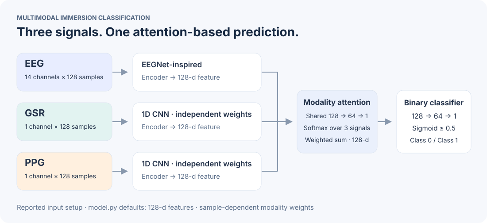
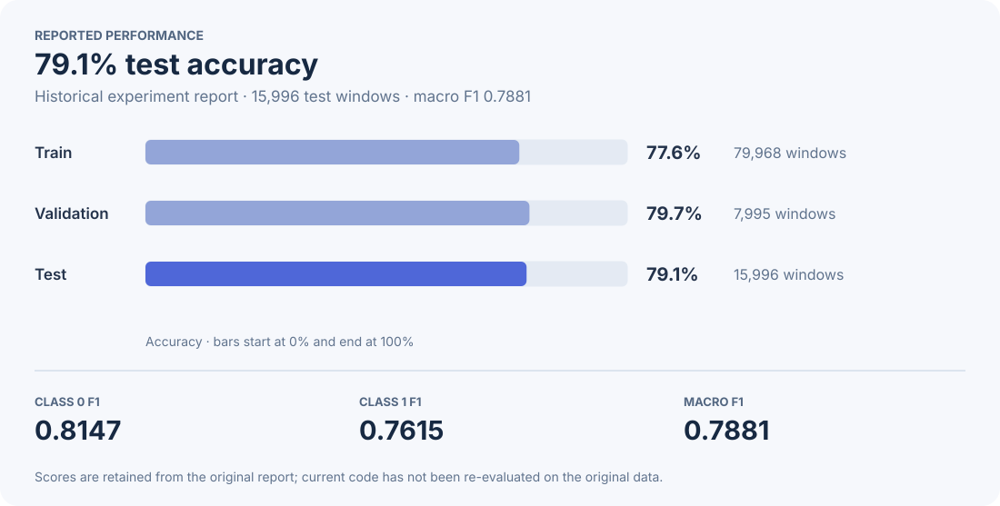

<div align="center">

# Multimodal Immersion Classification

**Learning immersion states from EEG, GSR, and PPG**

Biosignal analysis &nbsp;·&nbsp; Modality attention &nbsp;·&nbsp; PyTorch

[Architecture](#model) · [Performance](#reported-results) · [Quick start](#getting-started) · [Notebook](train.ipynb)

</div>

---

## At a Glance

| Task | Inputs | Fusion | Reported test accuracy |
| :--- | :--- | :--- | ---: |
| Binary immersion classification | EEG + GSR + PPG | Sample-dependent modality attention | **79.1%** |

This project explores how complementary physiological signals can be combined for binary immersion classification. Each modality has its own encoder; attention weights the resulting features before classification.

**My contribution:** I designed the fusion model and prepared a preprocessing pipeline for signal segmentation and cross-modal standardization. This repository contains the model, a loader for preprocessed arrays, and training code. The original signal collection and preprocessing workflow are not included.

## Model



| Stage | Implementation |
| :--- | :--- |
| EEG encoder | Temporal convolutions, grouped convolution, pooling, and feature projection; inspired by EEGNet |
| GSR / PPG encoders | Separate 1D CNNs with the same architecture and independent parameters |
| Attention fusion | Shared scoring network → softmax across modalities → weighted sum |
| Classification | 128 → 64 → 1, with ReLU and dropout; sigmoid threshold 0.5 |
| Training | Adam · binary cross-entropy with logits · early stopping on validation loss |

The diagram uses the default 128-dimensional features in [model.py](model.py). The EEG branch adapts EEGNet ideas rather than reproducing its architecture exactly.

## Reported Results



| Split | Signal windows | Accuracy |
| :--- | ---: | ---: |
| Train | 79,968 | 77.6% |
| Validation | 7,995 | 79.7% |
| **Test** | **15,996** | **79.1%** |

| Test class | Precision | Recall | F1 |
| :--- | ---: | ---: | ---: |
| 0 | 0.7663 | 0.8696 | 0.8147 |
| 1 | 0.8288 | 0.7044 | 0.7615 |
| **Macro average** | **0.7976** | **0.7870** | **0.7881** |

> **Result provenance:** These values are retained from the original experiment report, not a fresh evaluation of the current code. Raw data, original split lists, and the trained checkpoint are not distributed here, so the scores cannot be independently reproduced from this repository alone.

## Data Preparation

<details>
<summary><strong>Array format, split lists, and participant checks</strong></summary>

The reported experiment used 14-channel EEG, single-channel GSR and PPG, and windows of 128 samples. Supply preprocessed NumPy arrays with matching filenames across modalities:

```text
data/
├── DATA_SLICED/
│   ├── EEG_sliced/
│   │   ├── 0/
│   │   └── 1/
│   ├── GSR_sliced/
│   │   ├── 0/
│   │   └── 1/
│   └── PPG_sliced/
│       ├── 0/
│       └── 1/
└── data_splits/
    ├── train.txt
    ├── val.txt
    └── test.txt
```

Each split file contains one exact filename (including `.npy`) or class-relative filename per line. The loader also accepts CSV, JSON, and NumPy split files. Labels come from the `0` and `1` folders; missing paired files cause an error.

For participant IDs, use `--split-kind subject`. The default subject pattern reads the prefix before `_` or `-`; set `--subject-pattern` for other naming conventions.

Use `[channels, time]` for one EEG window and `[time]` or `[1, time]` for GSR/PPG. Add a leading window dimension for stacked files. Convert time-first arrays and extra singleton dimensions explicitly before loading.

Use explicit, non-overlapping split lists. File overlap is rejected before training. For unseen-participant evaluation, use subject split lists or enable `--check-subjects` with a matching subject pattern; the program rejects overlapping participant IDs. The original label protocol and participant allocation are not included.

</details>

## Getting Started

Use Python 3.10 or later.

```bash
git clone https://github.com/yunakinn/multimodal-immersion-classification.git
cd multimodal-immersion-classification
python -m venv .venv
source .venv/bin/activate
python -m pip install -r requirements.txt
```

After preparing the arrays and split lists:

```bash
python train.py \
  --data-dir ./data/DATA_SLICED \
  --split-dir ./data/data_splits \
  --output-dir ./outputs \
  --epochs 50 \
  --batch-size 8 \
  --seed 42
```

CUDA is used when available; otherwise the script runs on CPU. Arrays are memory-mapped by default; only the requested window is copied into a tensor.

### Outputs

- `outputs/best_model.pt`: checkpoint selected by validation loss.
- `outputs/learning_curves.png`: training and validation curves.
- `outputs/metrics.json`: run arguments, split sizes, learning history, and test metrics.
- Terminal: test accuracy, confusion matrix, and per-class metrics.

For notebook exploration, install Jupyter separately and open `train.ipynb`. To run the tests, install `pytest` and run `python -m pytest`.

## Repository Guide

| File | Purpose |
| :--- | :--- |
| [model.py](model.py) | Modality encoders, attention fusion, and classifier |
| [dataset.py](dataset.py) | Paired array loading and split selection |
| [train.py](train.py) | Training, checkpointing, plots, and test evaluation |
| [train.ipynb](train.ipynb) | Notebook experiment workflow |

## Limitations

Single-modality comparisons and evaluation on unseen participants are not reported.

