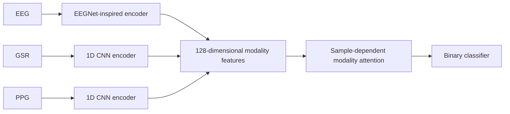

# Multimodal Immersion Classification

Classifying immersion states from EEG, GSR, and PPG signals with a multimodal neural network.

**Biosignal analysis · Multimodal learning · PyTorch**

[Results](#reported-results) · [Model](#model) · [Run](#getting-started) · [Notebook](train.ipynb)

## Overview

This project explores how complementary physiological signals can be combined for binary immersion classification. Each modality has its own encoder; an attention module combines the resulting feature vectors before classification.

My work included designing the fusion model and preparing a preprocessing pipeline for signal segmentation and cross-modal standardization. This repository contains the model, a loader for preprocessed arrays, and training code; it does not include the original signal collection or preprocessing workflow.

## Reported Results

The following values are retained from the original experiment report.

| Split | Signal windows | Accuracy |
| :--- | ---: | ---: |
| Train | 79,968 | 77.6% |
| Validation | 7,995 | 79.7% |
| Test | 15,996 | **79.1%** |

| Test class | Precision | Recall | F1 |
| :--- | ---: | ---: | ---: |
| 0 | 0.7663 | 0.8696 | 0.8147 |
| 1 | 0.8288 | 0.7044 | 0.7615 |
| Macro average | 0.7976 | 0.7870 | 0.7881 |

These are historical results, not a fresh evaluation of the current code. The raw data, original split lists, and trained checkpoint are not distributed here, so the reported scores cannot be independently reproduced from this repository alone.

## Model



- **EEG:** temporal convolutions, a grouped convolution, pooling, and a feature projection.
- **GSR and PPG:** separate CNN encoders with the same architecture and independent parameters.
- **Fusion:** a shared scoring network assigns a weight to each modality feature; softmax normalizes the three weights for each sample.
- **Training:** Adam, binary cross-entropy with logits, and early stopping on validation loss. Predictions use a sigmoid threshold of 0.5.

The EEG branch is inspired by EEGNet; it is not presented as an exact reproduction of the original architecture.

## Data Preparation

The reported experiment used 14-channel EEG, single-channel GSR and PPG, and windows of 128 samples. Supply preprocessed NumPy arrays with matching filenames across modalities:

```text
data/
├── DATA_SLICED/
│   ├── EEG_sliced/
│   │   ├── 0/
│   │   └── 1/
│   ├── GSR_sliced/
│   │   ├── 0/
│   │   └── 1/
│   └── PPG_sliced/
│       ├── 0/
│       └── 1/
└── data_splits/
    ├── train.txt
    ├── val.txt
    └── test.txt
```

Each split file can contain one filename per line. The loader also accepts CSV, JSON, and NumPy split files and can expand stacked windows within a file. Labels are read from the `0` and `1` folders.

Use explicit, non-overlapping split lists. For evaluation on unseen participants, construct participant-disjoint splits before running: the loader selects files but does not generate or verify participant-disjoint splits. The original label protocol and participant allocation are not included.

## Getting Started

Use Python 3.10 or later for the type syntax in the current source.

```bash
git clone https://github.com/yunakinn/multimodal-immersion-classification.git
cd multimodal-immersion-classification
python -m venv .venv
source .venv/bin/activate
python -m pip install -r requirements.txt
```

After preparing the arrays and split lists:

```bash
python train.py \
  --data-dir ./data/DATA_SLICED \
  --split-dir ./data/data_splits \
  --output-dir ./outputs \
  --epochs 50 \
  --batch-size 8 \
  --seed 42
```

CUDA is used when available; otherwise the script runs on CPU. The default loader caches the selected arrays in memory.

### Outputs

- `outputs/best_model.pt`: checkpoint selected by validation loss.
- `outputs/learning_curves.png`: training and validation curves.
- Terminal: test accuracy, confusion matrix, and per-class metrics.

For notebook exploration, install Jupyter separately and open `train.ipynb`.

## Repository Guide

| File | Purpose |
| :--- | :--- |
| [model.py](model.py) | Modality encoders, attention fusion, and classifier |
| [Dataset.py](Dataset.py) | Paired array loading and split selection |
| [train.py](train.py) | Training, checkpointing, plots, and test evaluation |
| [train.ipynb](train.ipynb) | Notebook experiment workflow |

## Limitations

The reported results do not establish a benefit over single-modality baselines or generalization to unseen participants. Those conclusions require explicit ablations and a documented split protocol. This is an experimental immersion classifier, not a clinical assessment tool.


